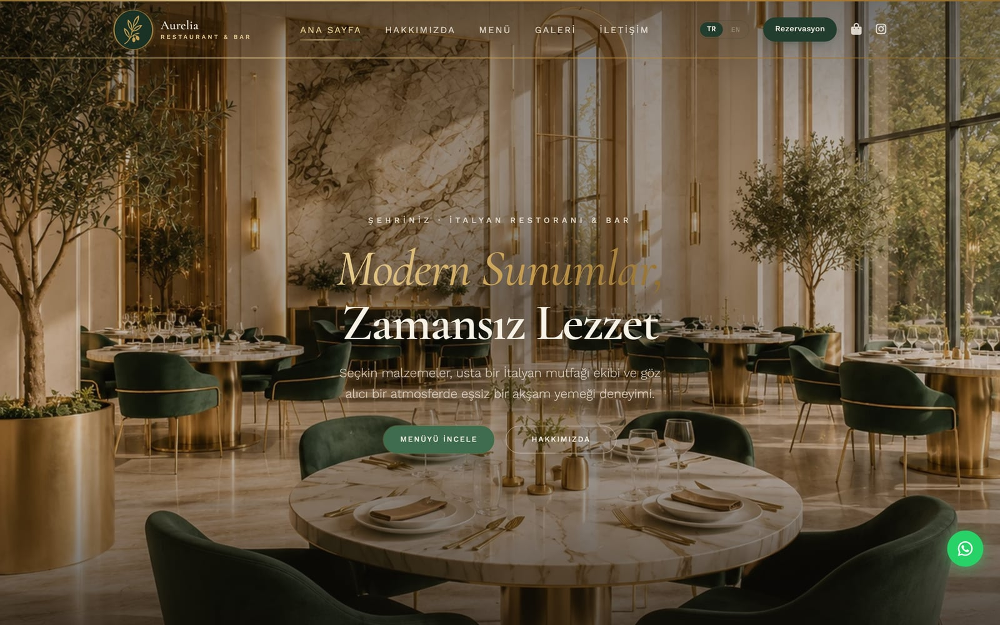
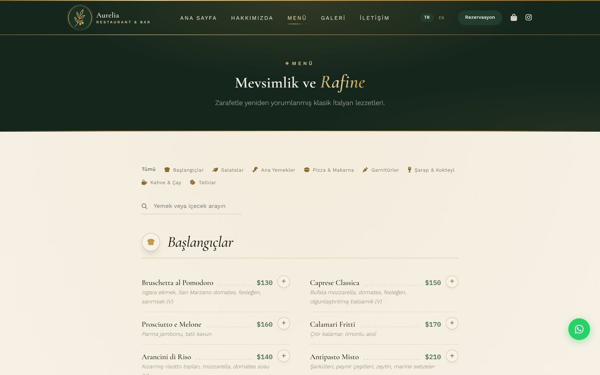

# Aurelia — Restaurant Website Template

A ready-to-sell website template for restaurants and small businesses, designed and built from scratch. No framework, no build step, no backend: upload the files to any static host and the site works.

**[Live demo](https://aurelia-restaurant-website-template.vercel.app)** · [Türkçe](README.md)

| Home | Menu and cart |
| --- | --- |
| [](https://aurelia-restaurant-website-template.vercel.app) | [](https://aurelia-restaurant-website-template.vercel.app/menu.html) |

## About

What a small restaurant needs from its website is usually simple: show the menu, take orders and reservations. Setting up a database, an admin panel or a paid monthly service for that is unnecessary overhead. In Aurelia, the order, reservation and contact forms all turn into a pre-filled WhatsApp message, so the owner receives orders in an app they already use.

Since the buyer may not know how to code, I also built a visual setup wizard. Restaurant details, colors, fonts, the menu, page text and photos are edited in the browser, and the finished site files are downloaded as a ZIP.

## Features

- **9 pages:** Home, About, Menu, Gallery, Reservation, Contact, FAQ, Privacy Policy and 404
- **Cart and WhatsApp ordering:** Guests add dishes from the menu, adjust quantities in the cart and send the order as a WhatsApp message in one click. The reservation and contact forms work the same way.
- **Setup wizard (`setup-wizard.html`):** 6 color palettes, 6 font pairings, a menu editor and text/photo editing on a live preview of the site. Everything stays in the browser; nothing is sent anywhere.
- **Turkish / English:** The language switcher updates every page, the menu, and all form and cart text together.
- **SEO:** Schema.org JSON-LD for the restaurant and the menu (51 items, 8 sections), Open Graph, `sitemap.xml`, `robots.txt`
- **Also:** Dismissible announcement bar, print-friendly menu, responsive layout, `prefers-reduced-motion` support

## Technical notes

- All text comes from a single dictionary in `assets/js/app.js`, referenced by `data-i18n` keys. The selected language and the cart are stored in `localStorage`.
- The WhatsApp number is defined only in `assets/js/site-config.js`; every WhatsApp link on the site is generated from it.
- Colors, fonts and spacing are CSS custom properties at the top of `style.css`. The wizard applies palettes by changing these variables.
- The wizard opens the site's own pages in its preview, writes the edits back into the files and packages them client-side with [JSZip](https://stuk.github.io/jszip/).
- The menu is an array in `menu.html` and the gallery is a set of HTML blocks in `gallery.html`, so no extra tooling is needed to edit content.

## Running

No installation needed: open `index.html` in a browser. To use the setup wizard, open `setup-wizard.html` from the same folder.

To run it on a local server:

```bash
npx serve .
```

To publish, upload the folder as-is to Vercel, Netlify, GitHub Pages or any web host. Step-by-step instructions are in [Getting-Started-Guide.pdf](Getting-Started-Guide.pdf).

## Project structure

```
├── index.html, about.html, menu.html, gallery.html,
│   reservation.html, contact.html, faq.html, privacy-policy.html, 404.html
├── setup-wizard.html        # setup wizard
├── sitemap.xml, robots.txt
└── assets/
    ├── css/style.css
    ├── js/site-config.js    # WhatsApp number
    ├── js/app.js            # language, announcement bar, shared behavior
    ├── js/cart.js           # cart and order message
    ├── img/
    └── video/               # optional videos (see README.txt)
```

## Tech stack

HTML, CSS, JavaScript (no framework) · JSZip · Font Awesome · Google Fonts

## License

This is a commercial template; see [LICENSE.txt](LICENSE.txt) for the terms.

---

Design and development: **Efnan Yılmaz** · [LinkedIn](https://linkedin.com/in/efnanyilmaz)
