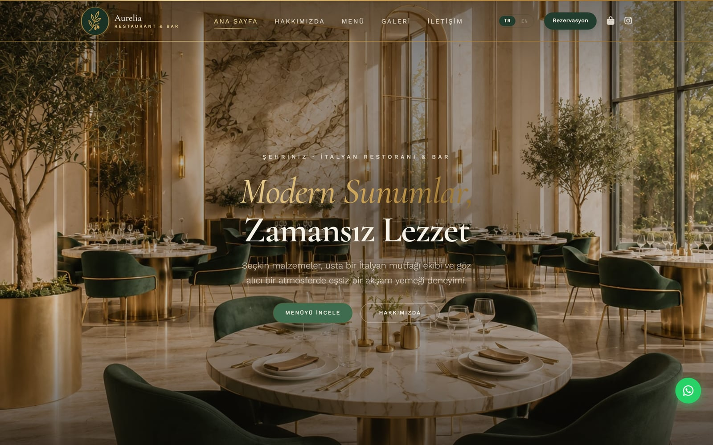
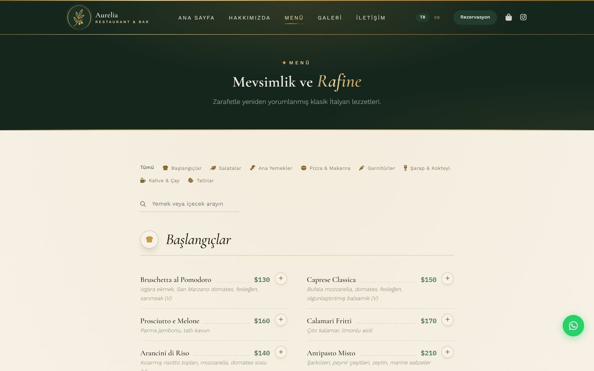

# Aurelia — Restoran Web Sitesi Şablonu

Restoranlar ve küçük işletmeler için tasarlayıp kodladığım, satışa hazır bir web sitesi şablonu. Framework, build adımı ya da backend gerektirmez; dosyalar herhangi bir statik sunucuya yüklendiği anda çalışır.

**[Canlı demo](https://aurelia-restaurant-website-template.vercel.app)** · [English](README.en.md)

| Ana sayfa | Menü ve sepet |
| --- | --- |
| [](https://aurelia-restaurant-website-template.vercel.app) | [](https://aurelia-restaurant-website-template.vercel.app/menu.html) |

## Proje hakkında

Küçük bir restoranın web sitesinden beklediği şey genellikle basit: menüyü göstermek, sipariş ve rezervasyon almak. Bunun için bir veritabanı, panel ya da aylık ücretli bir servis kurmak gereksiz bir yük. Aurelia'da sipariş, rezervasyon ve iletişim formlarının hepsi önceden doldurulmuş bir WhatsApp mesajına dönüşüyor; işletme sahibi siparişleri zaten kullandığı uygulamadan alıyor.

Şablonu satın alacak kişinin kod bilmeyebileceğini düşünerek bir de görsel kurulum sihirbazı ekledim. Restoran bilgileri, renkler, yazı tipleri, menü, metinler ve fotoğraflar tarayıcı üzerinden düzenleniyor; sonuçta hazır site dosyaları ZIP olarak indiriliyor.

## Özellikler

- **9 sayfa:** Ana sayfa, Hakkımızda, Menü, Galeri, Rezervasyon, İletişim, SSS, Gizlilik Politikası ve 404
- **Sepet ve WhatsApp siparişi:** Menüden ürün eklenir, adetler sepette değiştirilir ve sipariş tek tıkla WhatsApp mesajı olarak gönderilir. Rezervasyon ve iletişim formları da aynı şekilde çalışır.
- **Kurulum sihirbazı (`setup-wizard.html`):** 6 renk paleti, 6 yazı tipi eşleşmesi, menü düzenleyici ve sitenin canlı önizlemesi üzerinde metin/fotoğraf düzenleme. Her şey tarayıcıda kalır, hiçbir veri bir yere gönderilmez.
- **Türkçe / İngilizce:** Dil seçici tüm sayfaları, menüyü, form ve sepet metinlerini birlikte değiştirir.
- **SEO:** Restoran ve menü için Schema.org JSON-LD (51 ürün, 8 kategori), Open Graph, `sitemap.xml`, `robots.txt`
- **Diğer:** Kapatılabilir duyuru çubuğu, yazdırmaya uygun menü, mobil uyumlu tasarım, `prefers-reduced-motion` desteği

## Teknik notlar

- Tüm metinler `data-i18n` anahtarlarıyla `assets/js/app.js` içindeki tek bir sözlükten geliyor. Seçilen dil ve sepet `localStorage`'da tutuluyor.
- WhatsApp numarası yalnızca `assets/js/site-config.js` içinde tanımlı; sitedeki tüm WhatsApp bağlantıları buradan üretiliyor.
- Renkler, yazı tipleri ve boşluklar `style.css` başındaki CSS değişkenlerinde. Sihirbaz paletleri bu değişkenleri değiştirerek uyguluyor.
- Sihirbaz sitenin kendi sayfalarını önizlemede açıyor, düzenlemeleri dosyalara işliyor ve [JSZip](https://stuk.github.io/jszip/) ile istemci tarafında paketliyor.
- Menü, `menu.html` içindeki bir dizi; galeri, `gallery.html` içindeki HTML blokları. İçerik düzenlemek için ayrı bir araç gerekmiyor.

## Çalıştırma

Kurulum gerekmez, `index.html` dosyasını tarayıcıda açmak yeterli. Kurulum sihirbazını kullanmak için `setup-wizard.html` dosyasını aynı klasörden açın.

Yerel sunucu ile çalıştırmak isterseniz:

```bash
npx serve .
```

Yayınlamak için klasörü olduğu gibi Vercel, Netlify, GitHub Pages ya da herhangi bir hostinge yüklemek yeterli. Ayrıntılı kullanım adımları [Getting-Started-Guide.pdf](Getting-Started-Guide.pdf) dosyasında.

## Klasör yapısı

```
├── index.html, about.html, menu.html, gallery.html,
│   reservation.html, contact.html, faq.html, privacy-policy.html, 404.html
├── setup-wizard.html        # kurulum sihirbazı
├── sitemap.xml, robots.txt
└── assets/
    ├── css/style.css
    ├── js/site-config.js    # WhatsApp numarası
    ├── js/app.js            # dil, duyuru çubuğu, ortak davranışlar
    ├── js/cart.js           # sepet ve sipariş mesajı
    ├── img/
    └── video/               # isteğe bağlı videolar (bkz. README.txt)
```

## Teknolojiler

HTML, CSS, JavaScript (framework yok) · JSZip · Font Awesome · Google Fonts

## Lisans

Ticari bir şablondur; kullanım koşulları [LICENSE.txt](LICENSE.txt) dosyasındadır.

---

Tasarım ve geliştirme: **Efnan Yılmaz** · [LinkedIn](https://linkedin.com/in/efnanyilmaz)
