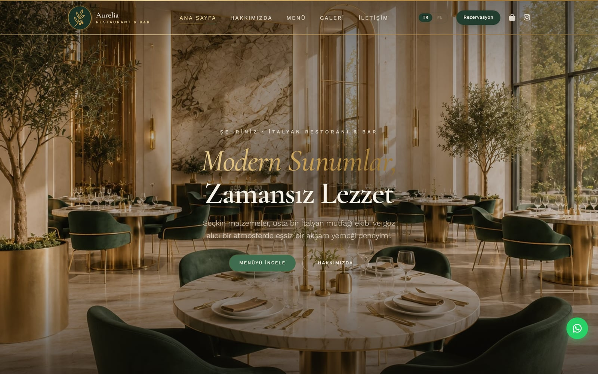
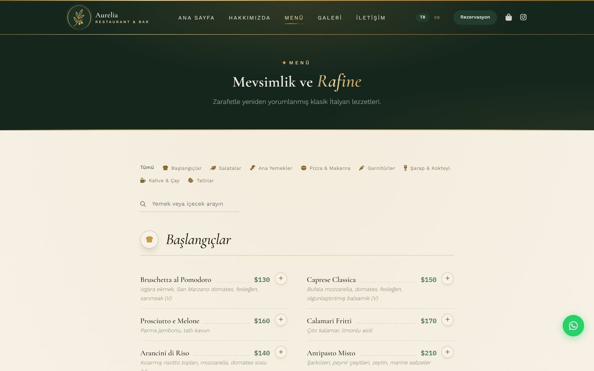

# 🍽️ Aurelia — Restoran Web Sitesi + Sepet

**🔗 [Canlı Demo](https://aurelia-restaurant-website-template.vercel.app)**  ·  🇬🇧 [English](README.md)

Restoranlar ve küçük işletmeler için **framework'süz (sade HTML/CSS/JS)** web sitesi başlangıç kiti.

| Ana sayfa | Menü ve sepet |
| --- | --- |
| [](https://aurelia-restaurant-website-template.vercel.app) | [](https://aurelia-restaurant-website-template.vercel.app/menu.html) |

**Backend yok, veritabanı yok, üçüncü taraf servis yok, build adımı yok.** Her sayfa statik HTML/CSS/JS — herhangi bir dosyayı doğrudan tarayıcıda aç, anında çalışır. İçerik (menü öğeleri, galeri fotoğrafları) doğrudan sayfa dosyalarının içinde yaşar. Misafire dönük her işlem — sipariş, rezervasyon, genel sorular — **WhatsApp** üzerinden yürütülür, yani kaydolunacak bir şey yok ve site tamamen çalışır hale gelmeden önce ayarlanacak hiçbir şey yok.

Kutudan çıktığı gibi 17 gerçek, profesyonel kalitede iç mekân ve yemek fotoğrafıyla gelir (`assets/img/`) — site ilk günden eksiksiz görünür. Hazır olduğunda kendi fotoğraflarınla değiştir (kurulum sihirbazının görsel editörü bunu fotoğraf başına tek tıkla yapılan bir işe çevirir — aşağıdaki Hızlı Başlangıç'a bak).

---

## 📦 Neler İçeriyor

- **9 sayfa:** Ana Sayfa, Hakkımızda, Menü, Galeri, Rezervasyon, İletişim, SSS, Gizlilik Politikası ve özel bir 404 sayfası
- **Canlı görsel editörlü, kod gerektirmeyen kurulum sihirbazı** (`setup-wizard.html`) — siteyi yeniden markala, bir renk paleti ve font eşleşmesi seç, menüyü yeniden yaz, sonra gerçek sayfa önizlemesine doğrudan tıklayarak metni yerinde düzenle ya da kendi fotoğraflarını yükle (Wix/Squarespace tarzı). Metin editörü gerekmez. Aşağıdaki Hızlı Başlangıç'a bak.
- **Düzenlenebilir duyuru çubuğu** — her sayfada başlığın üstünde ince, kapatılabilir bir çubuk (ör. "Bu akşam: 20:00'den itibaren canlı caz"). Mesajı her sayfanın HTML'inde doğrudan düzenle ya da bloğu silerek kapat; kapatan misafirler o tarayıcı oturumu boyunca çubuğu tekrar görmez.
- **Framework gerekmez** — build aracı yok, npm yok, webpack yok. Herhangi bir statik host'a (Hostinger, Netlify, Vercel, GitHub Pages, cPanel) doğrudan yüklenebilen sade HTML/CSS/JS.
- **Statik menü ve galeri** — yemekler ve fotoğraflar doğrudan `menu.html` ve `gallery.html` içinde sade dizi/HTML blokları. Normal bir web sayfası gibi düzenle; senkron tutulacak bir veritabanı yok.
- **Kutudan çıktığı gibi iki dilli (Türkçe / İngilizce)** — navbar'daki (ve mobil menüdeki) bir TR/EN anahtarı, `assets/js/app.js` içindeki tek bir `data-i18n` sözlüğü üzerinden her sayfayı anında değiştirir; menü kategorileri, yemek açıklamaları ve tüm dinamik form/sepet/bildirim metinleri dahil. Varsayılan dil Türkçe; sözlük nesnesini kopyalayarak üçüncü bir dil ekle.
- **Her şey WhatsApp üzerinden yürür:**
  - **Alışveriş sepeti** — misafirler Menü sayfasından yemek ekler, adetleri ayarlar ve önceden doldurulmuş bir sipariş mesajını doğrudan WhatsApp'ına göndererek sipariş verir (sepet tarayıcıda `localStorage` ile saklanır)
  - **Masa rezervasyonları** (`reservation.html`) — form; tarih, saat, kişi sayısı ve notlarla önceden doldurulmuş bir WhatsApp mesajı oluşturur
  - **İletişim formu** — genel sorular aynı şekilde önceden doldurulmuş bir WhatsApp mesajı açar
  - **Sabit WhatsApp butonu** — doğrudan sohbet için her sayfada
- **Temel SEO hazır** — restoran *ve* tüm menü için Schema.org JSON-LD (yemekler zengin arama sonuçlarında görünebilsin diye), Open Graph, Twitter Card, `sitemap.xml`, `robots.txt`
- **Yazıcı dostu menü** — ziyaretçiler menünün temiz, sade bir versiyonunu doğrudan tarayıcılarından yazdırabilir
- **Hafif gizlilik bildirimi** — sitenin local-storage kullanımını açıklayan, Gizlilik Politikası'na bağlantı veren tek seferlik bir banner
- **Özel 404 sayfası** — çıplak bir tarayıcı hatası yerine sitenin tasarımına uyan
- **Responsive tasarım** — mobil, tablet ve masaüstü; `prefers-reduced-motion` desteği ve ince bir sayfa yükleme animasyonuyla

---

## 🚀 Hızlı Başlangıç

### 0) Kod gerektirmeyen kurulum (önerilen)

**`setup-wizard.html`**'i herhangi bir tarayıcıda, doğrudan bu klasörün içinden aç (sadece çift tıkla — kurulum yok, sunucu yok). Bu klasörde tut — önizlemelerini oluşturmak için gerçek site dosyalarını yükler. Dört sekmesi var:

- **Restoran Bilgisi** — isim, WhatsApp numarası, iletişim bilgileri, Instagram kullanıcı adı, çalışma saatleri
- **Marka** — 6 renk paletinden ve 6 font eşleşmesinden birini seç; her sayfayı tek seferde yeniden renklendirir ve fontlar
- **Menü** — kategoriye göre yemek düzenle, ekle ya da çıkar
- **Metin ve Fotoğraf Düzenle** — gerçek sitenin canlı önizlemesi. Herhangi bir metne tıklayıp orada düzenle, herhangi bir fotoğrafa tıklayıp yerine yenisini yükle. Önizlemenin üstündeki sekmelerle sayfalar (Ana Sayfa, Hakkımızda, Menü, Galeri, İletişim, Rezervasyon, SSS) arasında geç.

**Web Sitemi Oluştur**'a tıkla, her şey doldurulmuş halde bir ZIP indirir. Bu klasöre çıkart (sorulduğunda üzerine yaz) ve işin bitti — başka kurulum gerekmez.

Gizlilik Politikası sayfasındaki hukuki metin dahil değildir — bunun için `privacy-policy.html`'i doğrudan düzenle. Diğer her şey tamamen tarayıcında gerçekleşir — yazdığın ya da yüklediğin hiçbir şey hiçbir yere gönderilmez.

Bunun yerine elle düzenlemeyi mi tercih edersin? 1. adıma geç.

### 1) Yerelde Çalıştır

Kurulum gerekmez — sadece `index.html`'i tarayıcında aç.

```bash
# isteğe bağlı, sadece video eklersen gerekir
python -m http.server 8000
# ya da
npx serve .
```

### 2) WhatsApp Numaranı Ayarla

**`assets/js/site-config.js`**'i aç — düzenlemen gereken tek dosya bu. `whatsapp` değerini restoranının numarasıyla değiştir; sitedeki her WhatsApp bağlantısı (sepet siparişi, iletişim formu, rezervasyon formu, tüm sabit butonlar) otomatik güncellenir. Sayfaları tek tek dolaşmana gerek yok.

```js
window.SITE_CONFIG = {
  whatsapp: "15551234567"
};
```

`+`, boşluk ya da baştaki sıfırlar olmadan uluslararası formatı kullan (ör. bir ABD numarası `+1 555 123 4567` → `15551234567`).

### 3) Dağıt

`assets/`, `*.html`, `sitemap.xml` ve `robots.txt` dosyalarını doğrudan host'una yükle (cPanel, Netlify, Vercel, GitHub Pages). Build adımı gerekmez.

---

## 🎨 Özelleştirme

- **Renkler ve tipografi:** En kolay yol kurulum sihirbazının **Marka** sekmesi (6 palet, 6 font eşleşmesi, her biri tek tık). Bunun yerine elle özelleştirmek için tüm renkler, fontlar ve boşluklar `assets/css/style.css`'in en üstünde, `:root` altında CSS özel değişkenleri olarak yaşar. Bir değeri değiştir, tüm siteye yayılır.
- **Marka adı / metin:** `data-i18n` özniteliği olan her öğe metnini `assets/js/app.js` içindeki tek bir sözlükten çeker.
- **Duyuru çubuğu:** Her sayfanın `<body>`'sinin üst kısmındaki `.announce-bar` bloğunun içindeki `<p>` metnini düzenle. Site genelinde kaldırmak için o bloğu her sayfadan sil (ya da öylece bırak — kapatan misafirler o oturumda tekrar görmez).
- **Görseller ve video:** `assets/img/` içindeki yer tutucu görselleri kendi fotoğraflarınla değiştir (aynı dosya adlarını koru, kod değişikliği gerekmez). Video eklemek için `assets/video/README.txt`'deki talimatları izle.
- **Menü öğeleri:** `menu.html`'i aç ve `MENU_ITEMS` dizisini doğrudan düzenle (dosyanın alt kısmına yakın, `<script>` etiketinin içinde). Her öğe `cat` (kategori anahtarı — hemen üstündeki `CAT_LABELS`/`CAT_LABELS_TR`'ye bak), `name`, `price` ve `desc` gerektirir (artı, Türkçeye özel bir çeviri için isteğe bağlı `descTr`/`nameTr`). Vejetaryen yemekleri açıklamanın sonuna ` (V)` ekleyerek işaretle.
- **Galeri fotoğrafları:** `gallery.html`'i aç ve `#galleryGrid` bloğunun içindeki `` etiketlerini doğrudan düzenle — `src`, `data-cat` (`mekan`/`kahve`/`atmosfer`) ve `alt` metnini güncelle ya da bir bloğu kopyalayıp yapıştırarak daha fazla fotoğraf ekle.
- **Gizlilik Politikası:** `privacy-policy.html` genel amaçlı bir şablon olarak gelir. Yayına girmeden önce işletmenin gerçek bilgileriyle güncelle ve sana uygulanan veri koruma yasalarına (KVKK, GDPR, CCPA ya da yerel karşılığı) uyarla — bir hukuk uzmanına incelettirmeyi düşün.

---

## 🗂 Klasör Yapısı

```
├── setup-wizard.html      # Kod gerektirmeyen kurulum aracı — önce bunu aç
├── index.html          # Ana sayfa
├── about.html           # Hakkımızda sayfası
├── menu.html             # Menü — MENU_ITEMS'ı doğrudan bu dosyada düzenle
├── gallery.html          # Galeri — görsel bloklarını doğrudan bu dosyada düzenle
├── reservation.html      # Masa rezervasyon formu (WhatsApp açar)
├── contact.html          # İletişim formu (WhatsApp açar)
├── faq.html               # Sıkça sorulan sorular
├── 404.html               # Özel "bulunamadı" sayfası
├── privacy-policy.html
├── sitemap.xml / robots.txt
└── assets/
    ├── css/style.css
    ├── js/site-config.js (WhatsApp numaranı burada düzenle), app.js, cart.js
    ├── img/               # Yer tutucu görseller (kendininkilerle değiştir)
    └── video/              # Boş — README.txt'ye bak
```

---

## ⚠️ Gereksinimler ve Notlar

- Modern tarayıcılar (Chrome, Firefox, Safari, Edge — son 2 sürüm)
- Siteyi olduğu gibi çalıştırmak için hesap, veritabanı ya da ücretli servis gerekmez
- Misafirlerin bir siparişi, rezervasyonu ya da iletişim mesajını tamamlamak için WhatsApp'ın kurulu olması (ya da WhatsApp Web) gerekir — WhatsApp kullanmayabilecek misafirler bekliyorsan bunu iletişim bilgilerinin yanında belirtmekte fayda var

## 📄 Lisans

Bu ürün, ekteki `LICENSE.txt` içindeki koşullar altında lisanslanmıştır. Kısaca: lisansının izin verdiği kadar çok kendi projende ya da müşteri projende kullan; kaynak kodunun kendisini rakip bir şablon olarak yeniden satamaz ya da dağıtamazsın.
